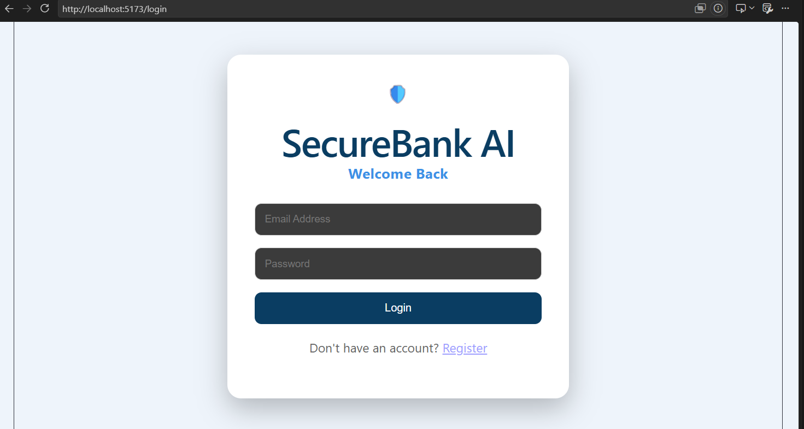
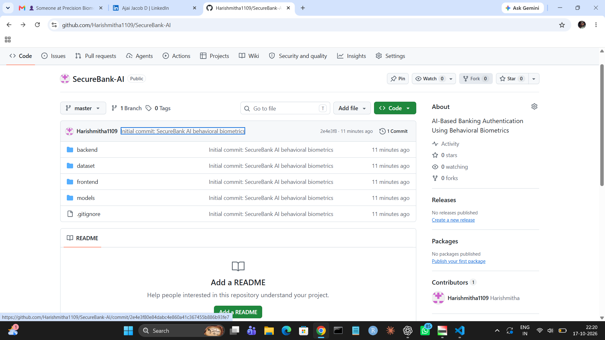
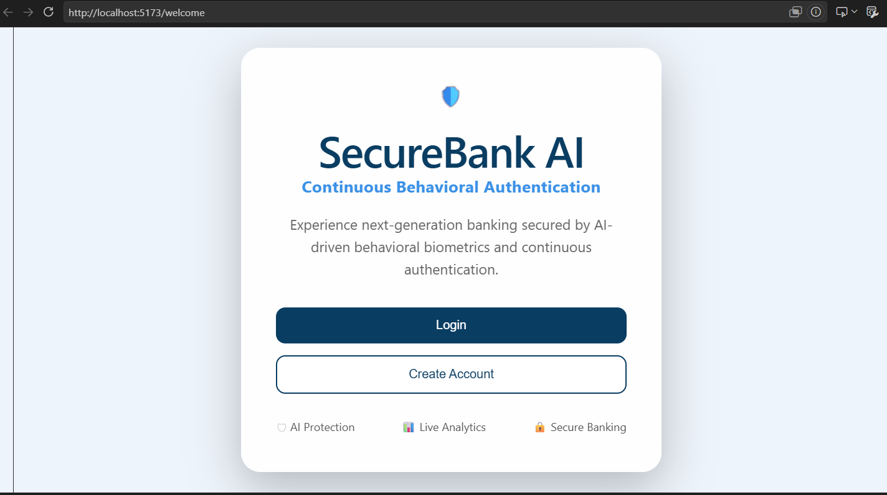
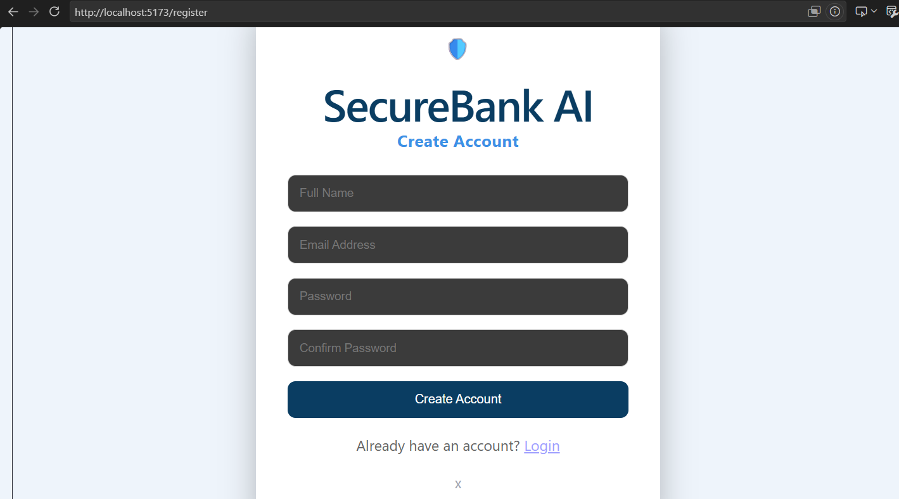
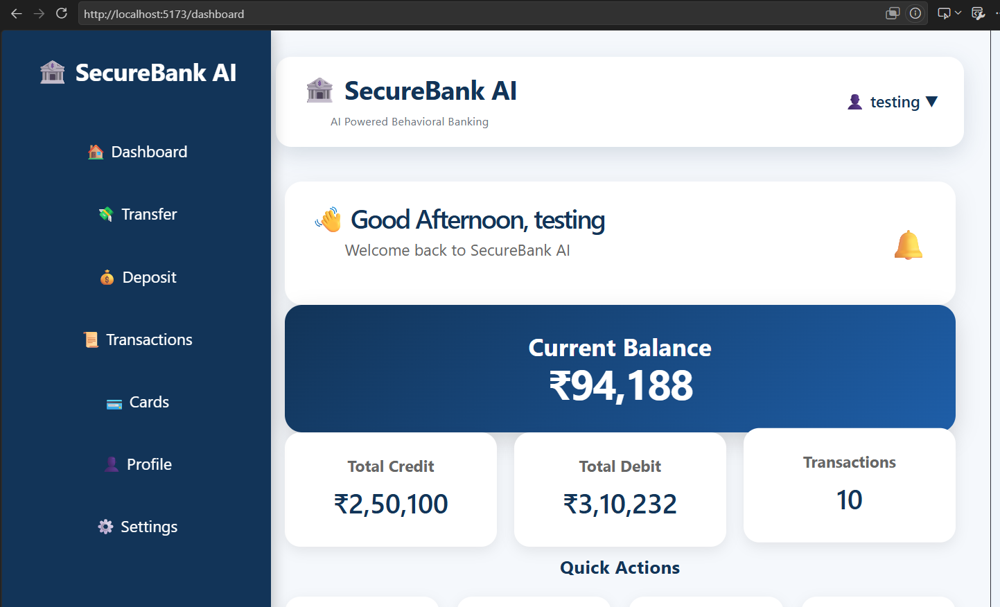
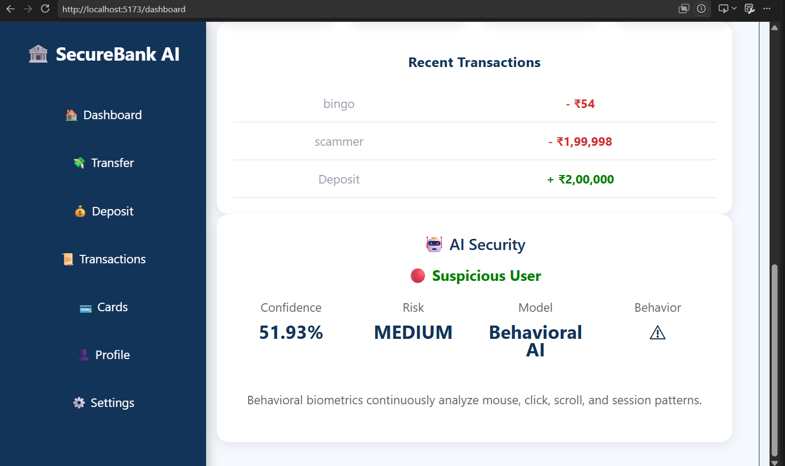
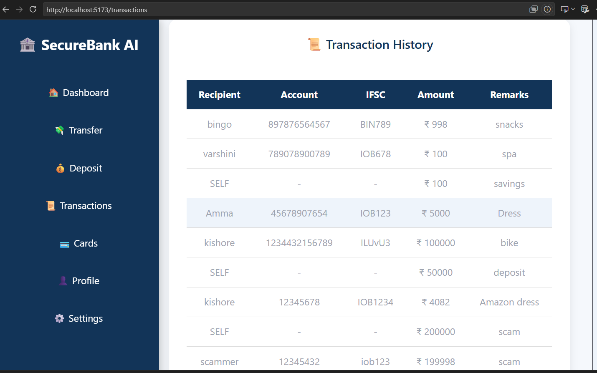
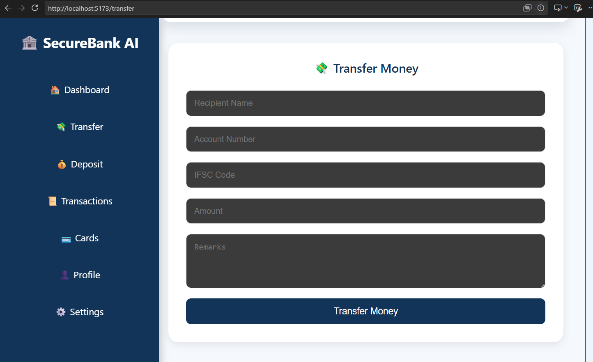
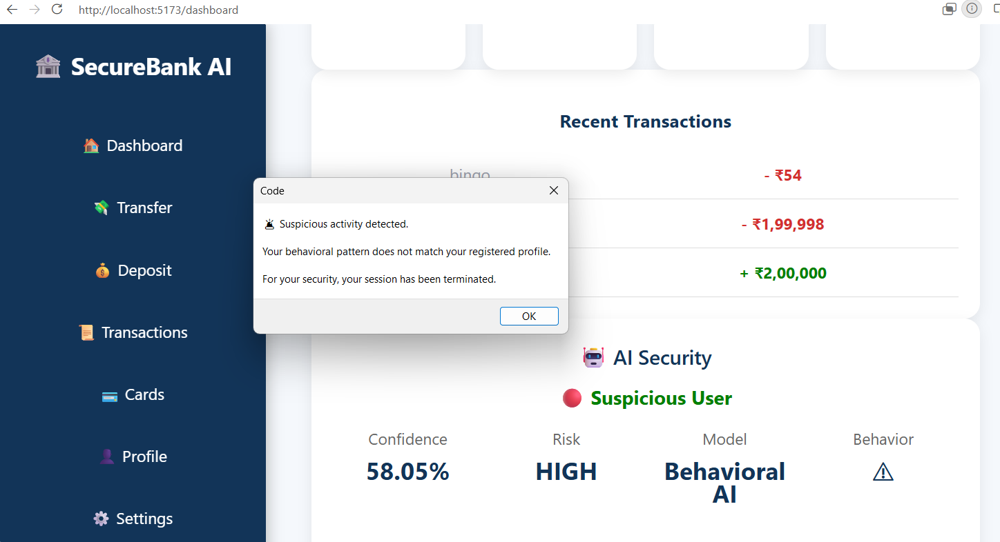

# 🔐 SecureBank AI
### An Intelligent Banking Authentication System Using AI-Based Behavioral Biometrics

SecureBank AI is a web-based banking authentication system that enhances security by analyzing user behavioral patterns during application usage. Instead of relying only on traditional login credentials, the system examines behavioral characteristics to identify unusual activity and assign a risk level.

The project combines a React frontend, Flask backend, MongoDB database, and statistical anomaly detection to provide an additional layer of security for banking applications.

---

## 🎯 Project Objectives

- Enhance banking authentication using behavioral biometrics.
- Collect and analyze user interaction patterns.
- Establish a personalized behavioral baseline.
- Detect deviations from normal user behavior.
- Classify activity into Low, Medium, and High risk levels.
- Demonstrate an additional security layer for web-based banking.

---

## ✨ Key Features

- **User Authentication:** Registration and login interface.
- **Behavioral Data Collection:** Captures mouse movement, clicks, scrolling activity, session duration, and device type.
- **Behavioral Dataset:** Stores extracted behavioral features for analysis.
- **Personalized Baseline:** Calculates statistical averages and standard deviations from historical behavioral windows.
- **Anomaly Detection:** Compares current behavior against the user's historical baseline.
- **Risk Classification:** Categorizes behavioral activity as Low, Medium, or High risk.
- **Security Monitoring:** Displays behavioral security information on the dashboard.
- **Controlled Anomaly Testing:** Provides a test endpoint for evaluating artificially abnormal behavioral patterns.

---

## 🧠 How It Works

1. **User Authentication**  
   The user registers or logs in to the web application.

2. **Behavioral Data Collection**  
   The frontend collects interaction information, including mouse movement, clicks, scrolling, session duration, and device type.

3. **Data Storage**  
   Behavioral records are stored in MongoDB.

4. **Dataset Preparation**  
   Behavioral records are processed into numerical features and organized into windows of 10 records.

5. **Baseline Generation**  
   Historical behavioral windows are used to calculate the mean and standard deviation for each feature.

6. **Anomaly Detection**  
   The latest behavioral window is compared against the historical baseline using statistical deviation scores.

7. **Risk Classification**  
   The system calculates a weighted anomaly score and classifies the result.

8. **Security Response**  
   The frontend monitors high-risk results and can terminate the current client-side session after three consecutive High-risk detections.

---

## 📊 Behavioral Features

The system analyzes 11 behavioral features across five categories.

| Category | Features |
|---|---|
| Mouse | Mean mouse distance, standard deviation of mouse distance, mouse activity rate |
| Click | Mean clicks, total clicks, click activity rate |
| Scrolling | Mean scroll distance, total scroll distance, scroll activity rate |
| Session | Session duration |
| Device | Device type |

---

## 🚦 Risk Classification

The system calculates a weighted statistical anomaly score.

| Anomaly Score | Risk Level | Interpretation |
|---|---|---|
| Below 30 | LOW | Behavior is relatively consistent with the baseline |
| 30 to below 55 | MEDIUM | Behavioral deviation detected |
| 55 or above | HIGH | Significant behavioral deviation detected |

**Note:** The anomaly score is a statistical deviation score, not a calibrated probability that a user is an attacker.

The frontend requires three consecutive High-risk detections before triggering its session-termination response.

---

## 🛠️ Technology Stack

### Frontend
- React
- JavaScript
- HTML5
- CSS3
- Vite

### Backend
- Python
- Flask
- Flask-CORS

### Database
- MongoDB
- PyMongo

### Data Processing and Analysis
- Pandas
- NumPy
- Statistical anomaly detection

### Development Tools
- Visual Studio Code
- Git
- GitHub
- MongoDB Compass

---
## 📸 Application Screenshots

### 1. Welcome Page


### 2. Splash Screen


### 3. Login Page


### 4. Registration Page


### 5. Banking Dashboard


### 6. Behavioral Risk Analysis


### 7. Transaction Page


### 8. Transfer Page


### 9. Suspicious Activity and Session Termination

## 📁 Project Structure

```text
SecureBank-AI/
│
├── backend/
│   ├── app.py
│   ├── database.py
│   ├── requirements.txt
│   ├── ml/
│   │   ├── create_dataset.py
│   │   └── train_model.py
│   ├── models/
│   │   └── behavior_model.pkl
│   └── routes/
│       ├── ai.py
│       ├── auth.py
│       ├── behavior.py
│       └── transaction.py
│
├── dataset/
│   └── behavior_dataset.csv
│
├── frontend/
│   ├── public/
│   ├── src/
│   │   ├── components/
│   │   ├── layout/
│   │   ├── pages/
│   │   ├── services/
│   │   └── styles/
│   ├── package.json
│   └── vite.config.js
│
├── models/
│   └── behavior_model.pkl
│
├── .gitignore
└── README.md